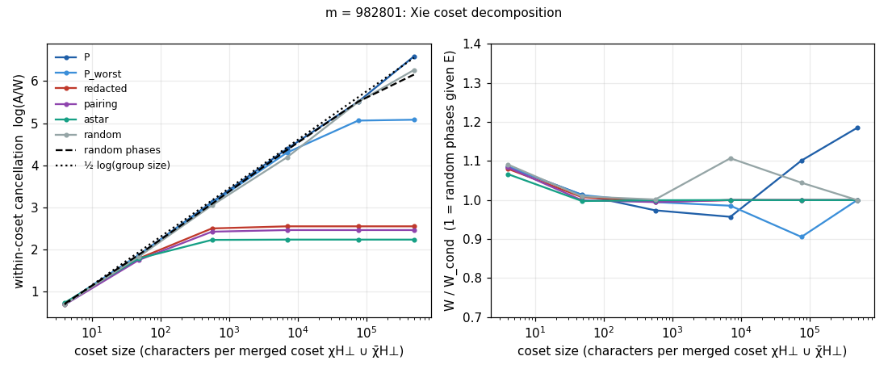
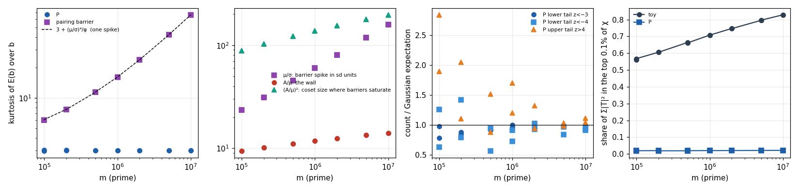

# Phase lab: first findings (m ≈ 10⁵ – 10⁷)

Written 2026-11-23 by the phase-lab agent. The orchestrator saved it, with the user's approval, after the harness
blocked the subagent's write. Code, CLI and conventions are in `README.md`.

Status tags, as in CLAUDE.md:
- **[computed]**: an exact or floating-point computation reproducible with the commands given.
- **[proved]**: a short exact identity, with its proof given here.
- **[heuristic]**: interpretation.

Notation (see `notes/01-parseval-wall.md`):
- t_χ(a) = χ̄(a)S(χ)²/φ, so E(a) = Σ_{χ≠χ0} t_χ(a);
- A = Σ|t_χ| = |P|(1 − ρ) is the Parseval mass (the wall);
- σ = rms_a E(a);
- the moduli are the primes m = 982801 (φ = 2⁴3³5²7·13, chosen for its many subgroups), 1000003 (φ = 2·3·166667) and
  100003 … 10000079 (scan), plus m = 994009 = 997², 10⁶ = 2⁶5⁶ and 510510 = 2·3·5·7·11·13·17.

Reproduce:
```
python3 -m phaselab report 982801          # and 1000000 510510 1000003 994009
python3 -m phaselab scan 100003 100019 200003 200009 500009 500029 1000003 1000033 2000003 2000029 5000011 5000077 10000019 10000079
```
The JSON outputs are in `data/` (gitignored, regenerable). The figures are in `fig/`.

The objects compared (`phaselab/objects.py`):
- **P**: at a seeded random a, and **P_worst** at argmin N.
- **conj**: |S|², at a = −1.
- **redacted**: P ∖ {p : a p̄ ∈ P}.
- **redacted_half**: remove only the larger element of each pair.
- **pairing**: a random set of density ρ containing at most one element of each pair {x, a x̄}.
- **random**: a random set of density ρ.
- **astar**: route A's A*, as the bilinear count P × a(A*)⁻¹.
- **toy**: Σ_{n≤√m}χ(n) to the 4th power.

---

## 0. Summary

1. **In every grouping of characters tried, the partial sums of E(a) over P behave like independent random phases.**
   - The groupings were by order, conductor, parity, |S| quantile, and Xie cosets χH^⊥ with coset size h from 4 to 5·10⁵.
   - Within-group cancellation equals the random-phase value to ±0.05 in log. For Xie cosets this is ½ log h, over five
     decades of h.
   - Given its total E(a), the vector of partial sums matches the conditioned Gaussian: W/W_cond = 1.00 ± 0.1 and
     χ²/dof ≈ 1. This holds at typical a and at the worst a. **[computed]**

2. **Every set barrier looks, in every linear decomposition, like P conditioned on N(a) = 0.**
   - The deficit −μ is a 57σ–85σ outlier for prime m ≈ 10⁶, and up to 180σ at m = 510510.
   - It is spread over groups in proportion to Σ_{χ∈g}|S(χ)|⁴, the Gaussian large-deviation allocation
     (W/W_cond = 1.000 in every Xie coset decomposition).
   - It is not concentrated on large characters, on low orders, or on any coset.
   - "Spike repair" (adding the missing μ back at a) restores P's kurtosis, skewness and ψ-correlations. **[computed]**

3. **Separating statistics.** Every statistic found that separates P from all barriers is a detector of the isolated
   spike at a:
   - (S1) Xie within-coset cancellation at coset size h ≫ (A/μ)² ≈ log² m. This is a-local and cheap, but it is at least
     as strong as EOS.
   - (S2) The kurtosis of b ↦ E(b). This is a-independent and cheap, but needs an 8-prime count to relative precision
     ≈ 1/φ.

   Route A's arc statistic separates A* only, and it is Type II data rather than a phase of S². **No localized phase
   pattern in χ ↦ χ̄(a)S(χ)² distinguishes P from the barriers.** **[computed; the "only" is over the statistics listed]**

4. **Phase dynamics in X carry no visible structure at X ≤ 4m.**
   - arg S_X(χ)² decorrelates over Δlog X ≈ 1 identically for P, the redacted set and a Cramér model.
   - The largest |S(χ)| at X = m acquire their size in the last e-fold of X.
   - S_X(χ)² and S_X(χψ)² are uncorrelated for ψ of order 2, 3, 4, 6. **[computed]**

5. **The smooth toy cancels in a different way.**
   - 0.1% of its characters carry 56% → 83% of Σ|T|² as m runs from 10⁵ to 10⁷. For P the figure is 2%, flat in m.
   - Its E is positively skewed (≈ 0.9), with kurtosis ≈ 5 and a truncated lower tail (z_min ≈ −3.0 to −3.6, against
     −4.1 to −5.6 for P). **[computed]**
   - This is a major-arc phenomenon that the primes do not share. **[heuristic]**

---

## 1. Where the cancellation happens (P)

Cancellation accounting at m = 982801 (`data/report_982801.json`):
- `within` = log(A/W) and `across` = log(W/|E|), where W = Σ_g|T_g|.
- "surr" is the same quantity with the |t_χ| kept and the phases made independent and uniform.
- `W/W_cond` compares W with a Gaussian surrogate conditioned on the observed total.

| grouping | groups | h | P (E/σ = −0.6): within (surr) | across | W/W_cond | P_worst (E/σ = −4.6): within (surr) | across | W/W_cond |
|---|---|---|---|---|---|---|---|---|
| order | 239 | – | 4.83 (4.67) | 2.32 | 0.92 | 4.39 (4.67) | 0.70 | 1.14 |
| \|S\| 20-quantiles | 20 | 49140 | 5.84 (5.43) | 1.31 | 0.89 | 4.99 (5.43) | 0.09 | 0.97 |
| Xie, H = G² | 245701 | 4 | 0.71 (0.71) | 6.43 | 1.09 | 0.71 (0.71) | 4.37 | 1.09 |
| Xie, H = G²⁴ | 20476 | 48 | 1.87 (1.87) | 5.28 | 1.01 | 1.87 (1.87) | 3.22 | 1.01 |
| Xie, H = G²⁸⁰ | 1756 | 560 | 3.12 (3.08) | 4.02 | 0.97 | 3.10 (3.08) | 1.98 | 0.99 |
| Xie, H = G³⁵¹⁰ | 141 | ≈ 7000 | 4.39 (4.36) | 2.75 | 0.96 | 4.30 (4.36) | 0.78 | 0.99 |
| Xie, H = G⁴⁰⁹⁵⁰ | 13 | ≈ 75600 | 5.51 (5.51) | 1.64 | 1.10 | 5.06 (5.51) | 0.02 | 0.91 |
| parity | 2 | 491400 | 6.59 (6.15) | 0.56 | 1.19 | 5.08 (6.15) | 0.00 | 1.00 |

The total log(A/|E|) is 7.14 for P and 5.08 for P_worst. The random-phase total is log(A/σ) ≈ ½ log φ ≈ 6.6. The same
pattern holds at m = 10⁶ (41 conductors; within 5.10, surr 5.26; W/W_cond 1.10), at m = 510510 (63 conductors; within
3.93, surr 4.21; W/W_cond 1.19), and at m = 1000003 and 994009.

**Reading.** **[heuristic]**
- At a typical a, the √φ cancellation splits between within and across exactly as group size dictates.
- At the extreme a, "across" collapses for coarse groupings: every group pulls the same way, as Gaussian conditioning
  predicts.
- At the scan's worst classes, W/W_cond = 0.93–1.12 at all 14 primes from 10⁵ to 10⁷.



*Left: within-coset cancellation against coset size. P and random follow ½ log h. Every barrier saturates at
log(A/μ) ≈ 2.5 once h ≳ (A/μ)² ≈ 140. Right: W/W_cond ≈ 1 for every object except conj (11.7).* For m = 10⁶ see
`fig/1000000_cosets.png`.

**Large characters or the bulk?** At the 200 worst a for P, the share of E(a) carried by each |S|-decile is
[0, 0, .005, .009, .021, .044, .059, .11, .20, .55]. The Gaussian-conditional prediction Σ_g|S|⁴/Σ|S|⁴ is
[0, .002, .005, .012, .023, .04, .067, .11, .20, .54]. A uniform phase bias would give the top decile only 0.31. The
top 0.1% of characters carry 2% of Σ|S|⁴, and max|S| ≈ 3·rms for every object. **[computed]**
(`fig/982801_allocation.png`)

**Phase histograms.** At a typical a the phases are uniform (Kuiper p = 0.26–0.65; harmonics c_2…c_8 within 2σ). The
weighted first harmonic is exactly c_1 = E(a)/A **[proved]**. Barrier histograms are tilted by c_1 ≈ −ρ/(1 − ρ), and
the tilt is proportional to |S(χ)|², as Gaussian conditioning predicts. **[computed]** (`fig/982801_phase_hist.png`)

---

## 2. Barrier objects

Separation table at m = 982801 (`python3 -m phaselab compare 982801`). In the table:
- W/W_cond is for the order, quantile and median Xie-coset groupings;
- "unw. c₁ z" is the unweighted mean cos θ in null-sd units;
- "arc" is route A's Σ_{k≤m/M} δ_M(a k̄)², relative to random, at M = √m.

| object | E(a)/μ | E/σ | max\|S\|/rms | W/W_cond | χ²/dof | unw. c₁ z | kurt E(b) | z_min | ψ-corr | arc |
|---|---|---|---|---|---|---|---|---|---|---|
| P | −0.009 | −0.6 | 2.95 | 0.92, 0.89, 1.05 | 1.01 | −0.4 | 3.01 | −4.6 | 2.5 | 1.03 |
| P_worst | −0.073 | −4.6 | 2.95 | 1.14, 0.97, 1.00 | 1.00 | −3.7 | 3.01 | −4.6 | 2.5 | 1.02 |
| conj (a = −1) | −1.000 | −62.6 | 2.95 | **11.66**, 1.27, **11.51** | **2455** | 0 | 3·10⁵ | −62.6 | **560** | – |
| redacted | −1.000 | −56.9 | 3.04 | 1.01, 1.00, 1.00 | 0.99 | −42.4 | **13.6** | −56.9 | 4.7 | 1.17 |
| redacted_half | −1.000 | −59.7 | 2.91 | 1.01, 1.00, 1.00 | 1.22 | −42.5 | **16.0** | −59.7 | 5.7 | 1.09 |
| pairing | −1.000 | −59.7 | 3.67 | 1.00, 1.00, 1.00 | 0.91 | −42.3 | **15.9** | −59.7 | 5.2 | 0.96 |
| astar | −1.000 | −84.4 | 2.88 | 1.00, 1.00, 1.00 | 1.00 | −67.0 | **54.6** | −84.4 | 9.1 | **4.44** |
| random | +0.022 | +1.3 | 3.42 | 0.95, 1.06, 1.03 | 1.00 | +0.7 | 3.01 | −4.7 | 2.3 | 0.94 |
| toy | −0.203 | −3.0 | **9.32** | 1.21, 1.00, 1.09 | 1.00 | −0.5 | **5.28** | −3.0 | 6.0 | – |

The same holds at m = 1000003, 994009, 10⁶ and 510510. At composite m the spikes are larger: up to 108σ (pairing) and
152σ (A*) at 10⁶, and 157σ–181σ at 510510.

**What the barriers look like.** **[computed]**
- *Sizes:* max|S|/rms is the same for all objects except the toy.
- *Linear partial sums:* W/W_cond = 1.00 and χ²/dof ≈ 1 for every set barrier in every Xie coset, order, conductor and
  quantile grouping.
- *Exceptions in two-group decompositions (parity, H = {±1}):* T_even(a) = ½(N(a) + N(−a)) − μ **[proved]**. So a
  point mass splits ½ : ½, while Gaussian conditioning predicts V_even : V_odd = ½ − O(ρ). This is a 1-dof effect of
  size ρ (χ² ≈ 20–57).
- *Spike repair* (T → T + (μ − N(a))χ(a)):

  | object (repaired) | kurt | skew | z_min | z_max | ψ-corr |
  |---|---|---|---|---|---|
  | redacted | 3.010 | 0.013 | −4.50 | +8.94 | 2.3 |
  | pairing | 2.999 | 0.014 | −4.46 | +4.83 | 2.3 |
  | astar | 2.990 | 0.015 | −4.62 | +5.01 | 2.2 |
  | P (for comparison) | 3.006 | 0.008 | −4.56 | +4.86 | 2.5 |

- *The echo in the redacted set:* the +8.9σ point is b = −a. The redacted set inherits P's reflection
  anti-symmetry (p and m − p are not both prime), which gives N'(−a) ≈ μ(1 + ρ/(1 − ρ)) ≈ +9σ. **[heuristic, matches]**
- *The conjugate problem is structurally different.* All its terms are real. Its deficit lives in the parity
  quotient: T_even(−1) = |P|/2 − μ and T_odd(−1) = −|P|/2. **[proved; N⁻(1) = |P| from the diagonal]**

### Separating statistics

| statistic | cheap? | separates | a-local? | could it be proved? |
|---|---|---|---|---|
| E(a) itself / weighted c₁ | yes | all | yes | it *is* EOS |
| (S1) Xie within-coset cancellation, h ≫ (A/μ)² ≈ log² m | yes | all, incl. conj | yes | at least EOS-strength |
| (S2) kurtosis of b ↦ E(b) | yes (one FFT) | all set barriers | no | needs power saving |
| (S3) ψ-twisted energy Σ_b E(b)²ψ(b), ψ of order ≤ 12 | yes | weakly (4–9σ against 2.5σ) | no | spike footprint |
| parity split | yes | conj only | – | — |
| route A arc statistic | yes | A* only (4.4× at 982801, 25× at 10⁶) | yes | route A's Type II input |
| \|S\| statistics | yes | none | – | — |
| phase histograms beyond c₁, Kuiper | yes | only through E(a) | yes | — |
| X-dynamics, χ/χψ coherence | yes | none | – | — |
| H4-type block kurtosis (global) | yes | none at m ≈ 10⁶ | no | — |

**Statement.** **[computed for the statistics above; the general claim is heuristic]** No grouping of characters
localizes the barrier deficit. In every family F tested, Σ_{χ∈F} χ̄(a)S(χ)² of a barrier equals the Gaussian-conditional
share (Σ_F|S|⁴/Σ|S|⁴)·(−μ) plus random-phase noise, apart from 1-dof parity effects of size ρ.

The two cheap statistics that separate P from every barrier are both spike detectors:
- **S1 (Xie coset L¹).** By T_C(a) = (1/|H|)Σ_{h∈H}N(ah)ξ(h) **[proved, tested]**, the spike puts −μ/|H| into every coset
  sum, so the barriers' within-coset cancellation is capped at log(A/μ). But a bound of the form
  (1/|H|)Σ_{ξ≠1}|T_ξ| ≤ εμ/|H| implies N(a) > 0 directly, so S1 is EOS-strength (Xie's strategy).
- **S2 (fourth moment over b).** For pairing barriers, kurt = 3 + (μ/σ)⁴/φ to 4 digits at every m; for P, kurt = 3.000
  ± 0.02. Proving "no spike" this way needs Σ_b N(b)⁴, an 8-prime count, to relative precision ≲ 1/φ.
  **[heuristic accounting]**

So the structure a proof must use is the absence of a single 60σ–160σ spike in b ↦ E(b), i.e. sub-Gaussian behaviour
of E at deviation μ, and not a localized phase pattern. Every cheap probe of it is either EOS-strength (S1) or needs
power-saving precision (S2). **[heuristic]**

**Tail shape of P (weak signal).** Over the 14 scan primes, the lower tail is 0.94 × Gaussian at z < −3 and 0.92 × at
z < −4. The upper tail is 1.40 × at z > 4, consistent with the p² ≡ b diagonal. **[computed; ≈ 2σ per modulus]**

---

## 3. Phase dynamics in X

Top 8 characters by |S| plus 24 random characters, X on a log grid in [√m, 4m]. **[computed]**

| object | weights | phase autocorr. lag 0.1 | lag 0.5 | lag 1.0 (in log X) |
|---|---|---|---|---|
| P | Cesàro·log | 0.96 | 0.62 | 0.34 |
| Cramér | Cesàro·log | 0.96 | 0.70 | 0.42 |
| redacted | Cesàro·log | 0.96 | 0.66 | 0.38 |
| P | sharp | 0.74 | 0.40 | 0.19 |
| Cramér | sharp | 0.79 | 0.47 | 0.30 |

- The phase of S(χ)² at X = m is set by the primes in roughly [m/e, m].
- The top |S(χ)| at X = m grow from ≈ 0.5√X at m/e to ≈ 4.5√X at m, then decay. They are random-walk excursions, not
  persistent large L-functions.
- χ/χψ coherence for ψ of order 2, 3, 4, 6 is null for P, redacted and Cramér alike.
- Route A block statistics: the global block kurtosis is 3.05–3.14 for P and 3.05–3.21 for the barriers. The arc
  statistic separates A* only. H4-type statements only have teeth once M ≫ (log m)⁵.

---

## 4. The smooth toy

N_toy(a) = #{n₁n₂n₃n₄ ≡ a, n_i ≤ √m}. **[computed]**
- The top 0.1% of characters carry 71% of Var_a E_toy at m ≈ 10⁶, rising from 56% at 10⁵ to 83% at 10⁷. For P the
  figure is 2%.
- The dominant characters have large order but satisfy χ(n) ≈ 1 on many small n (pretentious). **[heuristic]**
- E_toy has skew +0.86 to +0.99, kurtosis 4.7–5.4, and z_min −2.7 to −3.7. At 982801 there are 0 classes below −4σ,
  against 63 expected for a Gaussian.
- At the 200 worst classes the top characters carry 66% of the deficit, against 1.8% for P.

**Reading.** **[heuristic]** The toy's lower bound is a major-arc term that Weil/Kloosterman technology can evaluate,
and the primes have no such component. The toy calibrates the size of fluctuations, not the mechanism.

---

## 5. The range X > m

At m = 982801, A_X/μ_X ≈ 11.7·(m/X) (sharp) or ≈ 15.7·(m/X) (Cesàro), crossing 1 at X ≈ 11–16 m ≈ m log m. So with
the exact Parseval mass (a variance asymptotic, which GRH alone does not give) the wall disappears at X ≍ m log m. This
is the second layer of `notes/01-parseval-wall.md`. **[computed]**

---

## 6. Scaling (14 primes, 10⁵ – 10⁷)

| m | A/μ | min N/μ | kurt E (P) | z_min (P) | tails z<−3 / z<−4 / z>4 (÷ Gauss) | W/W_cond worst a | μ/σ (pairing) | kurt pairing obs / 3+(μ/σ)⁴/φ | toy kurt, skew, z_min | top-0.1% share toy / P |
|---|---|---|---|---|---|---|---|---|---|---|
| 100003 | 9.43 | 0.835 | 2.976 | −4.14 | 0.79 / 0.63 / 1.89 | 1.05, 1.11 | 23.4 | 5.98 / 6.02 | 4.83, 0.96, −2.87 | 0.56 / 0.019 |
| 200003 | 10.12 | 0.858 | 3.017 | −4.66 | 0.85 / 1.42 / 2.05 | 1.05, 0.97 | 31.1 | 7.65 / 7.68 | 4.93, 0.92, −2.98 | 0.61 / 0.020 |
| 500009 | 11.04 | 0.906 | 3.010 | −4.47 | 0.91 / 0.95 / 1.52 | 0.99, 1.07 | 45.2 | 11.34 / 11.37 | 5.25, 0.95, −2.91 | 0.66 / 0.019 |
| 1000003 | 11.74 | 0.921 | 3.008 | −4.95 | 1.00 / 0.92 / 1.71 | 1.00, 0.97 | 60.2 | 16.09 / 16.11 | 4.89, 0.88, −3.05 | 0.71 / 0.021 |
| 2000003 | 12.43 | 0.944 | 3.002 | −4.71 | 0.96 / 0.93 / 1.33 | 0.99, 0.93 | 80.4 | 23.91 / 23.92 | 5.36, 0.94, −3.27 | 0.75 / 0.021 |
| 5000011 | 13.35 | 0.961 | 2.999 | −4.80 | 0.98 / 0.97 / 1.04 | 0.98, 0.98 | 118.3 | 42.21 / 42.22 | 5.18, 0.88, −3.65 | 0.80 / 0.021 |
| 10000019 | 14.05 | 0.968 | 3.003 | −5.34 | 0.99 / 0.91 / 1.11 | 1.03, 0.94 | 158.9 | 66.82 / 66.83 | 5.34, 0.87, −3.43 | 0.83 / 0.022 |



The barrier spike grows like μ/σ ≈ √m/log m, and the coset size at which S1 bites grows like (A/μ)² ≈ log² m.
**[computed; asymptotic forms heuristic]**

---

## 7. Suggested next experiments

1. **Non-linear coset statistics.** The coset-L² Σ_{h∈H}E(ah)² for subgroups of index between log² m and m^{1/2}, to
   find the cheapest moment and index pair that separates.
2. **Phase-only (whitened) statistic.** Σ χ̄(a)S(χ)²/|S(χ)|². It detects barriers at −42σ, so whitening does not hide
   the spike. Its distribution over a for P may have lighter tails than E(a).
3. **F_q[t] at small q.** Port `sets.prime_weights` to irreducibles mod f in F_2[t] or F_3[t].
4. **Toy variants between the toy and P.** For example two primes times two smooth numbers, or the ternary count, to
   locate where the "major-arc + Gaussian bulk" shape becomes the "pure Gaussian bulk" shape of P.
